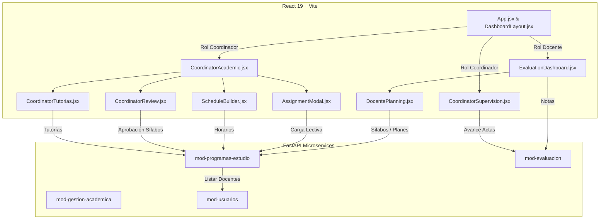

# Plan de Preparación y Mapeo: Módulos Docente y Coordinación de Programa

Este documento establece el entorno seguro de trabajo, respaldo de datos, base de datos de pruebas y el inventario técnico de los componentes correspondientes al rol **Docente** y al menú de **Coordinación de Programa**.

---

## 1. Entorno de Control de Versiones (Git)

- **Repositorio activo:** El proyecto cuenta con repositorio Git inicializado en la rama `main`.
- **Nueva Rama de Trabajo:** Se creó y activó la rama `mejoras/docente-coordinacion`.
- **Ajuste en `.gitignore`:** Se añadió la regla `backups/` para evitar que los volcados de base de datos se versionen accidentalmente en el repositorio.

---

## 2. Respaldo de Base de Datos y Verificación

- **Base de datos activa en PostgreSQL:** `siga_local` (host `127.0.0.1:5432`, usuario `postgres`).
- **Archivo de respaldo generado:** `backups/siga_backup_20261027_180101.sql` (tamaño: **3.76 MB**).
- **Conteo de estudiantes verificado:** **784 estudiantes** activos en BD y contenidos en el respaldo.
- **Comando exacto de restauración:**
  ```powershell
  # Restauración directa mediante psql:
  # Asegúrate de definir la variable en tu sesión o terminal:
  # $env:PGPASSWORD = "<PASSWORD_POSTGRES>"
  & "C:\Program Files\PostgreSQL\18\bin\psql.exe" -U postgres -h 127.0.0.1 -p 5432 -d siga_local -f "backups/siga_backup_20261027_180101.sql"
  ```

> [!NOTE]
> La versión del servidor PostgreSQL local es **18.4**. Los clientes `pg_dump` de versiones anteriores (ej. 16.x en contenedores) rechazan la conexión por diferencia de versiones mayores. Por ende, el respaldo se generó con la herramienta nativa 18.4 de la máquina.

---

## 3. Base de Datos de Pruebas (`siga_test`)

- Se creó la base de datos separada **`siga_test`** en la misma instancia de PostgreSQL:
  ```sql
  CREATE DATABASE siga_test;
  ```
- No se modificó ni alteró la base principal en producción/desarrollo local.

---

## 4. Inventario de Pruebas Automáticas

| Suite / Archivo | Tipo | Estado Actual | Comando de Ejecución |
| :--- | :--- | :---: | :--- |
| `mod-gestion-academica/test_enrollment_engine.py` | Unitest (Python puro, 14 casos) | **14/14 PASS** | `docker exec -w /app/modules/mod-gestion-academica siga_suiza_2026-mod-gestion-academica-1 python -m unittest test_enrollment_engine -v` |
| `mod-programas-estudio/test_connection.py` | Script de conectividad asyncpg | Informativo | `python test_connection.py` |
| `mod-usuarios/test_connection.py` | Script de conectividad asyncpg | Informativo | `python test_connection.py` |
| `siga_backend/tools/test_core.py` | Integración Core Identity | Script de verificación | `python tools/test_core.py` |
| `siga_frontend` (Linter) | ESLint 9 | Operativo | `cd siga_frontend; npm run lint` |
| `siga_frontend` (Vitest / Playwright) | Pruebas frontend | **No configurado** | Pendiente configurar Vitest si se requieren tests unitarios de componentes React |

---

## 5. Mapeo de Archivos: Docente y Coordinación de Programa



### A. Archivos del Rol Docente

* **Frontend:**
  - `siga_frontend/src/modules/evaluation/EvaluationDashboard.jsx`: Interfaz de selección de unidad, listado de estudiantes matriculados, registro de notas finales y generación de acta.
  - `siga_frontend/src/modules/academic/DocentePlanning.jsx`: Subida y gestión de sílabos y planes de trabajo docente.
  - `siga_frontend/src/layouts/DashboardLayout.jsx` y `src/App.jsx`: Navegación y redirección automática para el rol `docente`.
* **Backend:**
  - `siga_backend/modules/mod-programas-estudio/routes.py`:
    - `GET /docentes/{docente_id}/carga-lectiva`: Consulta de asignaturas asignadas al docente.
    - `POST /silabos` y `GET /docente/{docente_id}/silabos`: Registro y consulta de sílabos.
    - `POST /planes-trabajo` y `GET /docente/{docente_id}/planes-trabajo`: Planes de trabajo docente.
  - `siga_backend/modules/mod-evaluacion/routes.py`:
    - `GET /registros/unidad/{unidad_id}/periodo/{periodo_id}`: Lista de notas.
    - `PUT /registros/{registro_id}`: Actualización de calificación final.
  - `siga_backend/modules/mod-gestion-academica/routes.py`:
    - `GET /matriculas/unidad/{unidad_id}/periodo/{periodo_id}`: Lista de estudiantes inscritos en la unidad.

### B. Archivos de Coordinación de Programa

* **Frontend:**
  - `siga_frontend/src/modules/academic/CoordinatorAcademic.jsx`: Dashboard central del Coordinador Académico.
  - `siga_frontend/src/modules/academic/AssignmentModal.jsx`: Modal de asignación de carga docente por unidad didáctica y horas semanales.
  - `siga_frontend/src/modules/academic/ScheduleBuilder.jsx`: Creador interactivo de horarios por ciclo y sección.
  - `siga_frontend/src/modules/academic/CoordinatorReview.jsx`: Revisión y aprobación de sílabos y planes de trabajo entregados por los docentes.
  - `siga_frontend/src/modules/academic/CoordinatorTutorias.jsx`: Asignación de tutorías docentes por ciclo.
  - `siga_frontend/src/modules/evaluation/CoordinatorSupervision.jsx`: Supervisión global del llenado de notas y porcentaje de avance de actas.
* **Backend:**
  - `siga_backend/modules/mod-programas-estudio/routes.py`:
    - `POST /programas/{programa_id}/carga-lectiva`
    - `GET /programas/{programa_id}/carga-lectiva`
    - `POST /programas/{programa_id}/carga-lectiva/clonar`
    - `DELETE /programas/{programa_id}/carga-lectiva/{carga_id}`
    - `POST /programas/{programa_id}/horarios` y `GET /programas/{programa_id}/horarios`
    - `GET /programas/{programa_id}/silabos` y `PUT /silabos/{silabo_id}/estado`
    - `GET /programas/{programa_id}/planes-trabajo` y `PUT /planes-trabajo/{plan_id}/estado`
    - `POST /programas/{programa_id}/tutorias` y `GET /programas/{programa_id}/tutorias`
  - `siga_backend/modules/mod-evaluacion/routes.py`:
    - `GET /resumen/periodo/{periodo_id}`: Métricas de avance de actas.
  - `siga_backend/modules/mod-usuarios/routes.py`:
    - `GET /personal`: Catálogo de docentes habilitados para la asignación de carga.
